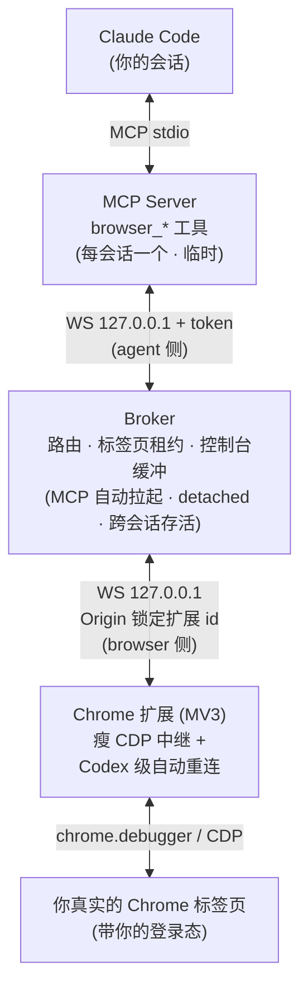
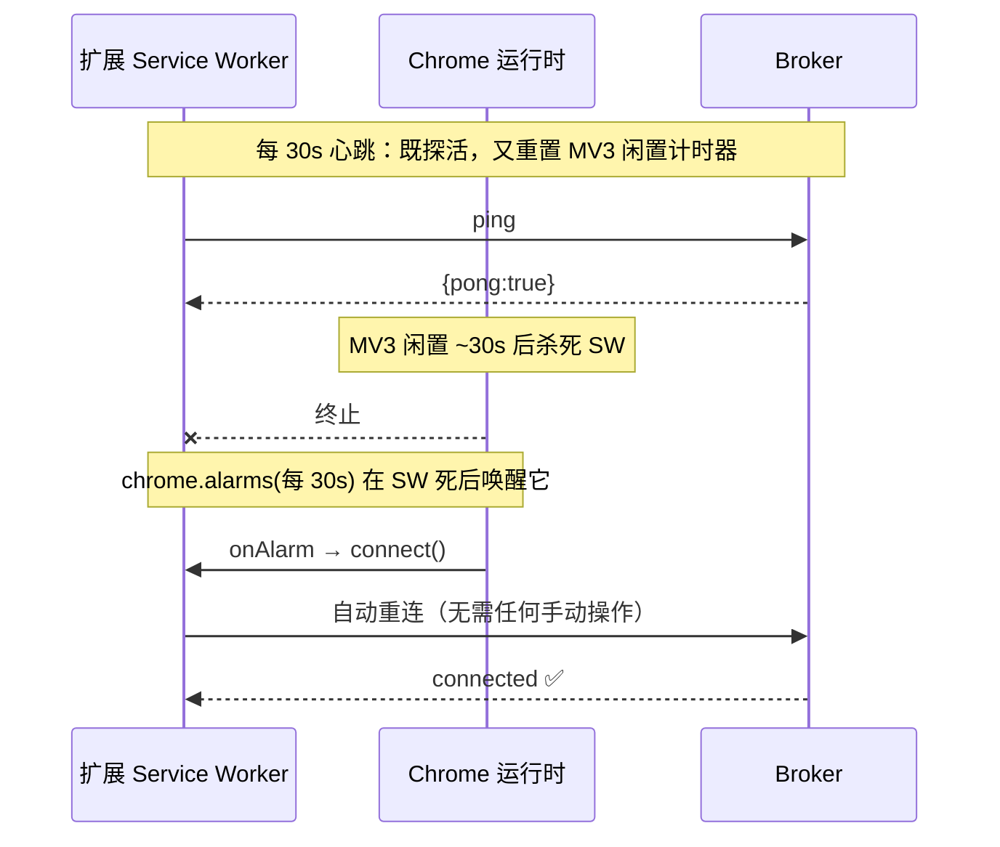

# claude-browser

> 给 Claude Code 的 **Codex 风格、永不需要手动重连** 的浏览器控制系统。
> 用你**真实的 Chrome（带你已登录的账号）**，截图 + 坐标操作 *和* 结构化 DOM 操作，全部从终端里的 Claude Code 驱动。


---

## ✨ 这是什么

`claude-browser` 让 **Claude Code（终端里的智能体）** 直接操控你日常用的 Chrome：导航、点击、输入、滚动、截图、读取无障碍快照、读控制台日志、跨标签页工作——就像 OpenAI Codex 的「电脑操控/浏览器」那样顺手，但是为 Claude Code 打造。

它由三个解耦的进程组成，用 **JSON-RPC 2.0 over 本地 WebSocket** 串起来。**它和官方 / 第三方方案最大的区别，就是稳定性**：一套从 Codex 扩展里逆向、再干净重写的「自愈重连」纪律，让连接**永远不需要你手动点 Reconnect**。

## 🤔 为什么要做它（而不是用现成的）

| 方案 | 功能 | 致命问题 |
|---|---|---|
| 第三方 `chrome-mcp` | 够用 | 连接经常掉，要反复手动重连 |
| 官方 Claude-in-Chrome | 功能齐全（原生消息、真实登录态、MCP 工具） | **官方文档自己承认**：扩展的 service worker 闲置后连接会断，需手动「Reconnect extension」；且闭源，无法修补 |
| **claude-browser** | 全混合（视觉坐标 + DOM 选择器 + 结构化读取） | —— 用 `chrome.alarms` 唤醒 + 心跳，**彻底消除手动重连** |

> 核心洞察来自逆向 Codex 的浏览器扩展：它稳定的秘密是 **`chrome.alarms` 在 service worker 被杀死后把它唤醒并自动重连 + 30s 心跳**。这恰恰是上面两个方案缺的那一环。本项目是对该架构的**干净重写**（可读、自有源码，不是 OpenAI 的压缩包）。

## 🏗️ 架构



**为什么这样就不会掉线**：Broker 由 MCP server 自动拉起（detached），比拉起它的会话活得久——新开 Claude 会话能在毫秒内接上；而扩展靠 alarm 自愈，比 service worker 的死亡活得久。两类「需要手动重连」的失效模式被分别根治。

## 🔁 稳定性机制（项目的灵魂）



- **扩展端**：service worker 一启动就连；断开时同时启动 **5s 定时重试** *和* **`chrome.alarms`（每 30s，能在 SW 被杀后存活）**；30s 心跳 ping，丢 pong 即重建。
- **Broker 端**：由 MCP server 自动拉起（detached + unref），跨会话存活、跨平台、无需系统服务；持有温热的扩展连接 + N 条 MCP 连接；MCP 重启时它毫发无伤。
- **MCP 端**：连不上 Broker 就把它拉起来（detached），自动重连；调用中断时返回可重试的结构化错误，绝不挂死。

## 🧰 工具（`browser_*`，全混合）

| 类别 | 工具 |
|---|---|
| 视觉 / 坐标 | `browser_screenshot` · `browser_click` · `browser_move` · `browser_type` · `browser_press_key` · `browser_scroll` · `browser_drag` |
| DOM / 结构化 | `browser_snapshot`（带稳定 `[refN]` 句柄的无障碍快照） · `browser_click_ref` · `browser_fill` · `browser_query` · `browser_get_text` · `browser_eval`（受权限控制） |
| 导航 / 标签页 | `browser_navigate` · `browser_back/forward/reload` · `browser_wait` · `browser_get_tabs` · `browser_new_tab` · `browser_switch_tab` · `browser_close_tab` |
| 调试 | `browser_console`（缓冲的控制台日志） |

> **「比 chrome-mcp 好用」的关键**：截图 + 带 `[refN]` 句柄的快照配合使用——Claude 既能*看见*页面，又能拿到*可靠的元素句柄*，比纯坐标（Codex）和纯 DOM（chrome-mcp）都更稳。

## 安装与使用（macOS / Windows / Linux）

**1. 注册 MCP（免 clone，一行命令）:**
```bash
claude mcp add claude-browser -- npx -y @john523100/claude-browser
```
Claude Code 会用 `npx` 拉起 MCP server，broker 自动拉起（无需常驻服务，跨平台）。

**2. 加载扩展:**
- 下载 [最新 Release](https://github.com/michael-ltm/claude-browser/releases) 里的 `claude-browser-extension-*.zip` 并解压；或运行 `npx -y @john523100/claude-browser extension-path` 打印已打包的扩展目录。
- 打开 `chrome://extensions` → 开启「开发者模式」→「加载已解压的扩展程序」→ 选该目录。
- 点开扩展 popup 给这个 profile 起名（默认自动用你的 Google 邮箱名）。

**3. 用:** 打开 Claude Code 会话，`/mcp` 里能看到 `browser_*` 工具，直接让它操作浏览器。

> Chrome 网上应用店一键安装为后续计划。开发者本地开发用 `npm run install:browser`（注册本地构建，不装常驻进程）。

## 🗂️ 项目结构

```
packages/
  shared/       JSON-RPC 协议契约 + 类型守卫
  broker/       守护进程（MCP 自动拉起）：路由 / 租约 / WS 鉴权 / 心跳
  extension/    MV3 扩展：瘦 CDP 中继 + 自愈重连 + 光标叠层 + popup
  mcp-server/   MCP stdio 服务：browser_* 工具 / CDP 构造器 / 自愈客户端
scripts/        一键安装 / 卸载 + 安装器辅助库
test/integration/  真实 Chrome 的 e2e + 稳定性 soak 测试
docs/superpowers/  设计规格 + 50 步实现计划
```

## 🧪 测试状态

- **215 个单元测试全部通过**（shared / broker / extension / mcp-server + 安装器辅助库），`tsc` 类型检查与构建全绿；CI 在 ubuntu + windows 上跑。
- 重连纪律（alarm + 心跳 + 重连）由 `transport.test.ts` 单测覆盖。
- e2e / soak 测试**已写好**，但需要能加载未打包扩展的浏览器（见下方限制）。

## ⚠️ 已知限制

- **自动化 e2e/soak 测试**依赖 `--load-extension` 命令行开关。**Chrome 137+（含 148）已移除该开关**，所以自动化测试需要 *Chrome for Testing* 或更老版本；**这不影响产品本身**——扩展通过「加载已解压」正常工作（即真实使用路径）。
- 使用 `chrome.debugger` 会出现 Chrome 自带的「正在调试此浏览器」横幅（与 Codex 一样，无法用扩展 API 隐藏）。
- Chrome 网上应用店一键安装仍为后续计划（当前通过「加载已解压」安装扩展）。

## 🙏 致谢

架构灵感来自对 **OpenAI Codex** 浏览器扩展的逆向分析（仅借鉴其稳定性模式：原生消息 → 本项目改用本地 WS；`chrome.alarms` 唤醒 + 心跳重连），并完全干净重写为可读的 TypeScript。

---

<sub>由 Claude Code 通过头脑风暴 → 规格 → 50 步 TDD 计划 → 子代理逐任务实现 + 双重审查的流程构建。</sub>
